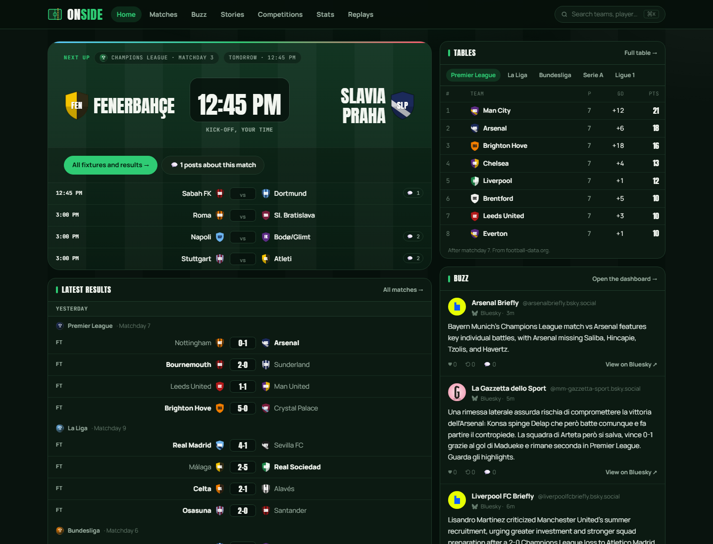
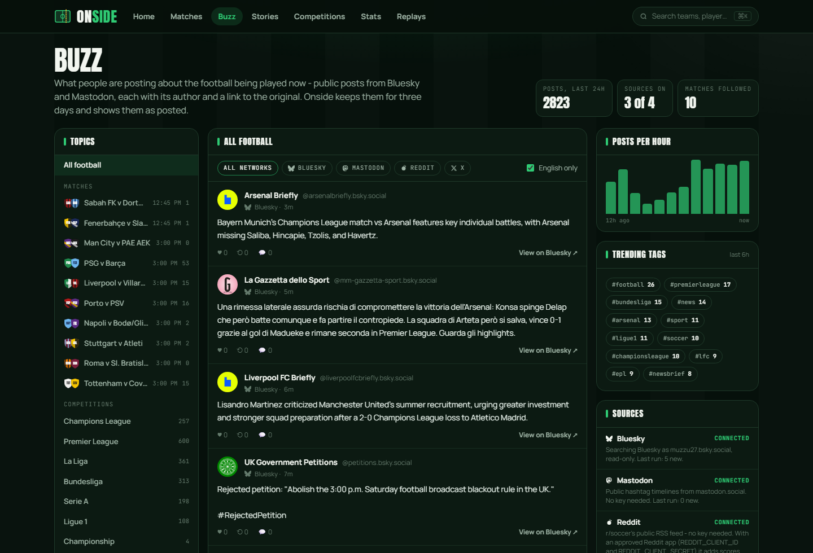
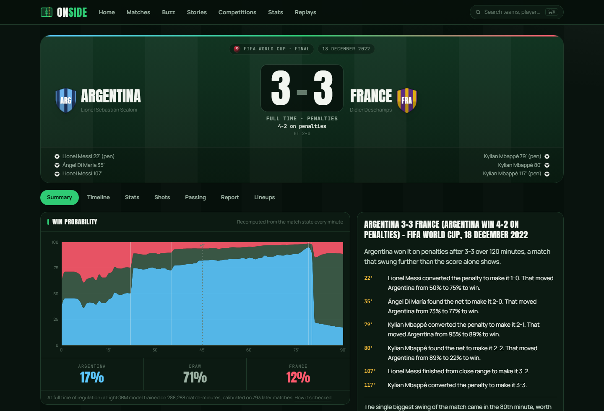

# Onside

**A football site that keeps the history straight.** Today's fixtures and
tables, what people are posting about them, and every match in the StatsBomb
open-data archive — including what the score *used to be* before VAR changed it.

[](https://github.com/muzammilkhan2784/onside/actions/workflows/ci.yml)

**Live: https://d3rtn1ent0xfw9.cloudfront.net** — running on AWS for £0.



---

## Why I built it

Every scores site shows you the number. None of them show you when the number
changed. A goal is given at 35', VAR rules it out at 37', and the goal simply
disappears — no record that it was ever given, and no way to ask what the score
was at 36'.

Onside never edits anything. Events are only ever added, and a correction is a
new event that says what it replaces. The score, the stats, the win probability
and the written report are all rebuilt from that list, so the history survives
and the page can tell you what changed and when.

## What's in it

- **Today's football** — fixtures, results, league tables and top scorers for 12
  competitions, refreshed every minute.
- **The archive** — 3,961 matches, 13.9 million events, 24 competitions, 1958 to
  2025. Every match has a page with a timeline, shot map, pass networks,
  line-ups and a report written from the events.
- **Buzz** — public posts about the matches being played, from Bluesky,
  Mastodon and Reddit, matched to the right fixture.
- **Replays** — re-run any archived match minute by minute through the live
  pipeline and watch a VAR correction land. Clearly marked as a replay, always
  showing the real result.
- **An API** — 48 endpoints at `/docs`, plus a 2.6 KB no-JavaScript page for
  every match at `/m/<id>`.

| | |
|---|---|
|  |  |
| Buzz: posts matched to fixtures | A match page: the 2022 final |

## Run it

You need Docker. One command:

```bash
docker compose up -d --build
```

Then open http://localhost:5173. The API docs are at http://localhost:8080/docs.

It builds the archive on first run if you don't have one. To switch on today's
fixtures and the social feed, copy `.env.example` to `.env` and add a free
[football-data.org](https://www.football-data.org/client/register) key and a
Bluesky app password. Without them, the site says which parts are off and why
instead of showing empty pages.

## How it's built

- **Python, FastAPI, React, TypeScript.**
- **Two stores, on purpose.** DynamoDB answers "this match, right now" in
  milliseconds. The same events also sit in Parquet, read by DuckDB, for
  questions like "every shot from outside the box in La Liga, by player" —
  783 ms there, against about 23 minutes the other way.
- **Redis Streams** carry events to the workers; browsers get updates over
  WebSockets.
- **A win-probability model** (LightGBM, 360,451 match-minutes). It is
  calibrated, and CI fails the build if that stops being true.
- **243 backend tests and 38 in the web app**, run on every push.

The longer version, with the measurements, is in
[docs/how-it-works.md](docs/how-it-works.md).

## On AWS, for nothing

The live site runs inside AWS's free allowances — CloudFront, Lambda, DynamoDB,
EventBridge and Parameter Store. Nothing in it is billed by the hour, so an idle
month costs nothing.

The one piece with no free tier is Redis, so the free version does without it:
what Redis holds is kept in a DynamoDB table instead, behind a class that
answers the same commands. Replays need Redis, so they are switched off there —
the site says so rather than offering a button that fails. Everything else is
the same code.

```bash
python infra/free_check.py        # is this account still free?
npx aws-cdk deploy OnsideFree     # deploy it
```

`free_check.py` looks for anything billed by the hour and says how much of each
free allowance has been used. The expensive stack (Fargate, Redis, a load
balancer) can't deploy by accident — it isn't in the app unless you ask for it
by name.

## Credit

Event data from [StatsBomb Open Data](https://github.com/statsbomb/open-data),
free for research and education. Current fixtures from
[football-data.org](https://www.football-data.org). Full terms in
[ATTRIBUTION.md](ATTRIBUTION.md). This is an independent project and is not
affiliated with StatsBomb.

> Data provided by StatsBomb.
